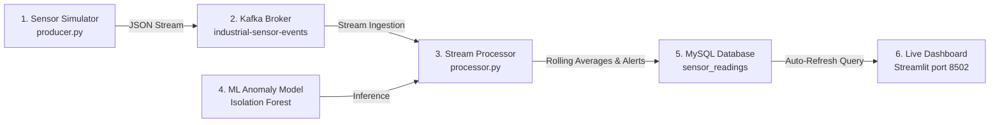

# Real-Time Industrial Equipment Fault Monitoring 🏭

A full-stack, six-layer Data Stream Analytics pipeline that simulates continuous industrial equipment sensor readings, streams them via Apache Kafka, analyzes them in real time with a Machine Learning Anomaly Detector (Isolation Forest) and industrial safety thresholds, persists readings into MySQL, and visualizes live telemetry on an auto-refreshing Streamlit dashboard.

---

## 📌 Project Architecture & Six Layers



| Layer | Component | Implementation | Description |
|---|---|---|---|
| **1. Data Source** | `producer.py` | Python generator | Generates realistic Temperature (°C), Vibration (mm/s), Pressure (bar), and RPM readings, injecting occasional simulated faults (overheating, high vibration, pressure drop, overspeed). |
| **2. Stream Transport** | Apache Kafka | KRaft Mode (Port 9092) | Publishes and consumes messages on the `industrial-sensor-events` topic with partition replication. |
| **3. Stream Processing** | `processor.py` | Python stream consumer | Ingests live Kafka events, computes 10-point rolling vibration averages, and prepares feature tensors. |
| **4. Machine Learning** | `fault_model.joblib` | Scikit-Learn Isolation Forest | Trained on synthetic baseline operating profiles; combined with domain safety thresholds for hybrid anomaly detection. |
| **5. Data Persistence** | MySQL 8.0 | `industrial_monitor` database | Stores structured readings, rolling averages, anomaly status (`0` = normal, `1` = anomaly), and timestamps in `sensor_readings`. |
| **6. Visualization** | `dashboard.py` | Streamlit (`http://localhost:8502`) | Live telemetry dashboard featuring equipment fleet cards, dual time-series charts, anomaly alert centers, and auto-refresh. |

---

## 💻 Prerequisites

- **Operating System:** Windows 10/11
- **Python:** 3.11 (or 3.10+)
- **Java:** Java 17 LTS (required for Apache Kafka)
- **Apache Kafka:** 3.7+ running in KRaft mode
- **MySQL:** MySQL Server 8.0 or Dockerized MySQL container listening on port `3306`

---

## 🚀 Setup & Installation

### 1. Clone & Set Up Python Virtual Environment
Open PowerShell or Command Prompt in the project directory:

```powershell
cd C:\Users\DELL\Downloads\industrial_fault_monitoring_project\industrial_fault_monitoring
python -m venv .venv
.\.venv\Scripts\Activate.ps1
python -m pip install --upgrade pip
pip install -r requirements.txt
```

### 2. Configure Environment Variables
Copy `.env.example` to `.env` and fill in your local MySQL password:

```powershell
Copy-Item .env.example .env
```

Edit `.env` with your preferred editor:
```ini
MYSQL_HOST=localhost
MYSQL_PORT=3306
MYSQL_USER=root
MYSQL_PASSWORD=your_actual_mysql_password
MYSQL_DATABASE=industrial_monitor
KAFKA_BOOTSTRAP_SERVERS=localhost:9092
KAFKA_TOPIC=industrial-sensor-events
MODEL_PATH=fault_model.joblib
```

> **Note:** `.env` is ignored by `.gitignore` to prevent committing secrets to version control.

### 3. Initialize MySQL Database Table
Open MySQL CLI or Workbench and run the schema script:

```sql
SOURCE schema.sql;
```
Or execute it via Python:
```powershell
python -c "import mysql.connector, config; conn=mysql.connector.connect(host=config.MYSQL_HOST, port=config.MYSQL_PORT, user=config.MYSQL_USER, password=config.MYSQL_PASSWORD); cur=conn.cursor(); [cur.execute(s) for s in open('schema.sql').read().split(';') if s.strip()]; conn.commit(); print('Database ready.'); conn.close()"
```

### 4. (Optional) Train or Retrain the ML Model
A pre-trained model artifact (`fault_model.joblib`) is included. To retrain the Isolation Forest on synthetic baseline data:

```powershell
python train_model.py
```

---

## 🏃 Running the Pipeline (Step-by-Step)

Run each component in a dedicated terminal window:

### Terminal 1: Apache Kafka Broker (KRaft Mode)
```powershell
$env:JAVA_HOME = "C:\Program Files\Java\jdk-17"
$env:PATH = "C:\Program Files\Java\jdk-17\bin;$env:PATH"
cd C:\kafka
.\bin\windows\kafka-server-start.bat .\config\kraft\server.properties
```

Ensure the topic exists (one-time setup):
```powershell
.\bin\windows\kafka-topics.bat --create --topic industrial-sensor-events --bootstrap-server localhost:9092 --partitions 1 --replication-factor 1
```

### Terminal 2: Stream Processor (ML Anomaly Scoring & DB Storage)
```powershell
cd C:\Users\DELL\Downloads\industrial_fault_monitoring_project\industrial_fault_monitoring
.\.venv\Scripts\Activate.ps1
python processor.py
```

### Terminal 3: Sensor Data Producer (Telemetry Simulator)
```powershell
cd C:\Users\DELL\Downloads\industrial_fault_monitoring_project\industrial_fault_monitoring
.\.venv\Scripts\Activate.ps1
python producer.py
```

### Terminal 4: Streamlit Dashboard
```powershell
cd C:\Users\DELL\Downloads\industrial_fault_monitoring_project\industrial_fault_monitoring
.\.venv\Scripts\Activate.ps1
streamlit run dashboard.py --server.port 8502
```

---

## 📊 Live Dashboard Access

Open your web browser and navigate to:
👉 **[http://localhost:8502](http://localhost:8502)**

Features include:
- **Equipment Fleet Status:** Live status badges for `MOTOR-01`, `PUMP-02`, and `COMPRESSOR-03`.
- **KPI Metrics:** Latest Temperature, Vibration, Pressure, RPM, and running Anomaly Rate.
- **Real-Time Sensor Telemetry:** Side-by-side time-series line charts.
- **Vibration Smoothing:** Current vibration vs. 10-point rolling average comparison.
- **Detected Anomaly Alerts:** Filtered view of flagged abnormal conditions with timestamps.
- **Auto-Refresh:** Configurable 1–10 second dynamic refresh (default: 3s).

---

## 📂 Project Structure

```text
industrial_fault_monitoring/
├── .env.example          # Template for environment variables (tracked)
├── .gitignore            # Excludes .venv, .env, __pycache__, and logs
├── config.py             # Centralized settings & safe .env loader
├── dashboard.py          # Streamlit live telemetry dashboard (port 8502)
├── fault_model.joblib    # Pre-trained Isolation Forest model artifact
├── processor.py          # Kafka consumer, ML anomaly detector, & MySQL writer
├── producer.py           # Realistic sensor data generator & fault injector
├── README.md             # Project documentation & execution guide
├── report_template.md    # Academic / faculty evaluation report template
├── requirements.txt      # Python dependencies
├── schema.sql            # MySQL table DDL schema
└── train_model.py        # Reproducible ML training script
```

---

## 🔍 Troubleshooting

| Symptom | Cause | Solution |
|---|---|---|
| `NoBrokersAvailable` | Kafka broker is not running on port 9092 | Verify Kafka terminal is running without errors and listening on `localhost:9092`. |
| `Access denied for user 'root'` | MySQL password mismatch | Check your password in `.env` and confirm the MySQL service/container is active. |
| `Port 8501 already in use` | Another web service is bound to 8501 | Run Streamlit with `--server.port 8502` as configured. |
| `UnicodeEncodeError: 'charmap'` | Windows code page console limitation | Handled automatically using clean ASCII log markers in `processor.py`. |

---

## ⚠️ Academic Disclaimer
This project uses synthetic industrial equipment readings for educational demonstration and streaming analytics evaluation. It is not intended for safety-critical industrial process control.
