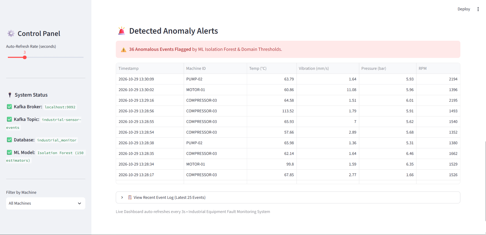
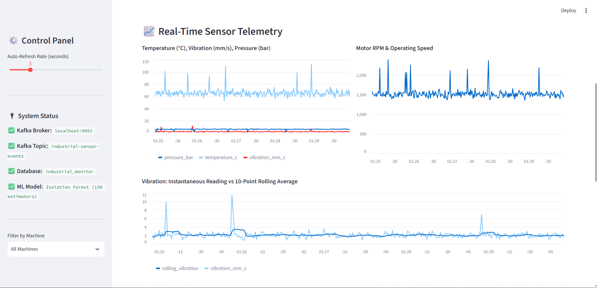

# Real-Time Industrial Equipment Fault Monitoring

A Data Stream Analytics mini-project demonstrating an end-to-end streaming pipeline for simulated industrial sensor data.

**GitHub repository:** [https://github.com/26yashu/industrial-equipment-fault-monitoring](https://github.com/26yashu/industrial-equipment-fault-monitoring)  
**Local dashboard:** [http://localhost:8502](http://localhost:8502)

## Dashboard Screenshots

### 1. Equipment fleet overview
Shows equipment status cards, latest sensor KPIs, anomaly counts, and the start of the telemetry section.



### 2. Real-time sensor telemetry
Shows temperature, vibration, pressure, RPM, and instantaneous vibration compared with its 10-point rolling average.



### 3. Detected anomaly alerts
Shows recent events flagged by the anomaly detection pipeline, including timestamps, machine IDs, and sensor readings.


## Project Architecture

1. **Sensor data source:** Python generates timestamped simulated readings for temperature, vibration, pressure, and RPM.
2. **Streaming platform:** Apache Kafka topic `industrial-sensor-events`.
3. **Stream processor:** Python consumes Kafka events and calculates a rolling vibration average.
4. **Anomaly detection:** Isolation Forest model combined with configured domain thresholds.
5. **Database:** MySQL database `industrial_monitor`, table `sensor_readings`.
6. **Visualization:** Streamlit dashboard with automatically refreshed KPIs, charts, and anomaly alerts.

## Technology Stack

- Python
- Apache Kafka
- scikit-learn / Isolation Forest
- MySQL
- Streamlit
- Pandas and joblib

## Run Locally

Use separate terminals for the broker, processor, producer, and dashboard. Make sure Kafka and MySQL are running and that your local environment variables/configuration are set correctly.

### 1. Install Python dependencies

```powershell
python -m venv .venv
.\.venv\Scripts\Activate.ps1
pip install -r requirements.txt
```

### 2. Start Kafka

Use the Kafka server configuration that matches the storage already initialized on your machine. For the existing local setup, the command used was:

```powershell
cd C:\kafka
.\bin\windows\kafka-server-start.bat .\config\server.properties
```

If your Kafka distribution uses a different configuration path, use the matching configuration file for your installation. Do not reformat initialized Kafka storage.

### 3. Start the stream processor

```powershell
python processor.py
```

### 4. Start the sensor producer

In another terminal, from this project directory:

```powershell
python producer.py
```

### 5. Start the dashboard

In another terminal:

```powershell
streamlit run dashboard.py --server.port 8502
```

Then open [http://localhost:8502](http://localhost:8502).

## Configuration and Security

- Use `.env.example` as a template for local configuration.
- Never commit `.env` files, passwords, API keys, database dumps, or virtual environments.
- Keep real credentials in environment variables or a local, ignored `.env` file.
- This project uses simulated sensor readings. An anomaly flag is an alert for an unusual or threshold-violating reading, not proof that physical equipment has failed.

## Project Report

The project report includes the system architecture, implementation, verification summary, limitations, future enhancements, and dashboard screenshots. Add the report DOCX to the repository if you want it available alongside the source code.
